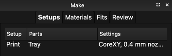
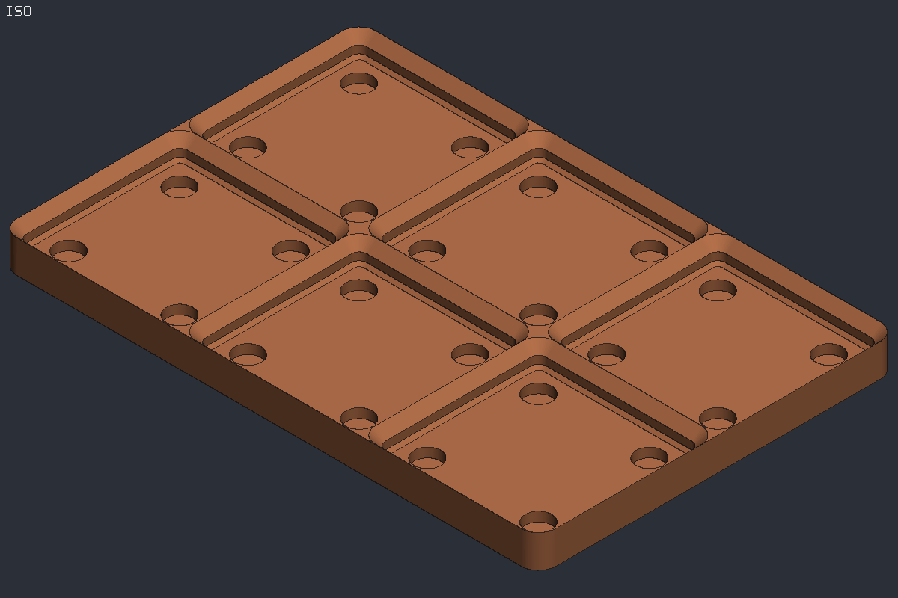
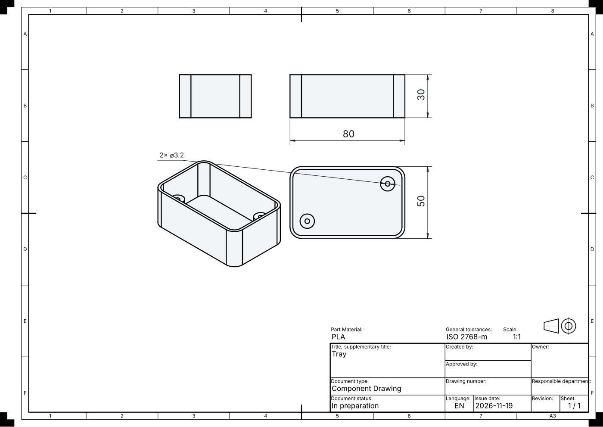

<!-- SPDX-License-Identifier: LGPL-2.1-or-later -->
# Workshop for FreeCAD

> Not affiliated with or endorsed by the FreeCAD project or the FreeCAD project association (FPA); FreeCAD is the FPA's trademark. Get FreeCAD itself from [freecad.org](https://freecad.org).

- [What it is](#what-it-is)
- [What you need](#what-you-need)
- [Install](#install)
- [First steps](#first-steps)
- [Screenshots](#screenshots)
- [Where things are](#where-things-are)
- [What an agent can do with it](#what-an-agent-can-do-with-it)
- [Troubleshooting](#troubleshooting)
- [Uninstall](#uninstall), [Privacy](#privacy)
- [Licence](#licence), [Credits](#credits)

## What it is

Workshop is one FreeCAD add-on for making things. It adds:

- **Standard parts**: Gridfinity bins and baseplates, project boxes, board boxes.
- **Make**: how each part is made (printed, laser-cut or milled), fits, holes for hardware, printability checks (DFM, design for manufacturing), slicing and printers.
- **Electronics**: a KiCad board read into FreeCAD, and an enclosure made round it.
- **Documents**: drawings in one click, assembly manuals, library packs.
- **SafetyNet**: checkpoints, recovered copies after a crash, settings history, and macros that run only after your approval.

Each feature sits in the FreeCAD workbench it belongs to, beside the FreeCAD tool it builds on.
Only what FreeCAD has no place for gets a workbench of its own, the small **Make** workbench.
Everything works with no other add-on installed.
When [Agent Link for FreeCAD](https://github.com/jamesK1000011/AgentLink-FreeCAD) is installed, the same functions are also tools an AI agent can call, in the background.
Agent Link is the hub: the add-on that connects an AI agent (Claude, for example) to FreeCAD through MCP, the Model Context Protocol.
Workshop does not need it.
Checks such as the DFM check, the part review and the strength of a frame tell you if a part is feasible. They are never a sign-off.

It brings together what used to be five add-ons: Workshop Parts, Make,
Electronics and Documents, and SafetyNet. Each part's own notes (its Python
API, data files and agent tools) are in [docs/](https://github.com/jamesK1000011/Workshop-FreeCAD/tree/main/docs/): [Parts](https://github.com/jamesK1000011/Workshop-FreeCAD/blob/main/docs/parts.md),
[Make](https://github.com/jamesK1000011/Workshop-FreeCAD/blob/main/docs/make.md), [Electronics](https://github.com/jamesK1000011/Workshop-FreeCAD/blob/main/docs/electronics.md),
[Documents](https://github.com/jamesK1000011/Workshop-FreeCAD/blob/main/docs/documents.md), [SafetyNet](https://github.com/jamesK1000011/Workshop-FreeCAD/blob/main/docs/safetynet.md).
How it plugs into Agent Link, with a diagram: [docs/workflow/](https://github.com/jamesK1000011/Workshop-FreeCAD/blob/main/docs/workflow/README.md).

**With Fasteners Workbench.** If you also have
[Fasteners Workbench](https://github.com/shaise/FreeCAD_FastenersWB) (Shai
Seger's add-on; its screw_maker is Ulrich Brammer's), Workshop works with it:
Hole for hardware can put the matching screw in the hole, drawings' bills of
materials and mass properties list its parts as bought hardware, and its
heat-set insert table and 3D-print thread settings are used before
Workshop's own typical figures. Agents get its fasteners as tools too (the
`fasteners` group below). Workshop calls Fasteners where it is installed
and copies none of it. Without Fasteners none of this shows. Notes:
[docs/fasteners.md](https://github.com/jamesK1000011/Workshop-FreeCAD/blob/main/docs/fasteners.md).

## What you need

- FreeCAD 1.1 or newer.
- Optional: [Agent Link for FreeCAD](https://github.com/jamesK1000011/AgentLink-FreeCAD) and an MCP client (for example Claude Desktop), so that an agent can use Workshop.
- Optional: a slicer (OrcaSlicer, Bambu Studio or PrusaSlicer) for slicing, KiCad files for boards, and [Fasteners Workbench](https://github.com/shaise/FreeCAD_FastenersWB) for screws.

## Install

Use one way, not two. If you had the separate add-ons or SafetyNet
installed, remove them first: two copies would show every command twice.

### With Agent Link's Claude Desktop extension (easiest)

1. Install [Agent Link for FreeCAD](https://github.com/jamesK1000011/AgentLink-FreeCAD#install) with its Claude Desktop extension.
2. Start a new chat.

The extension installs Workshop as `Mod/Workshop`. It sets aside the older separate folders
(`WorkshopParts`, `WorkshopMake`, `WorkshopElectronics`, `WorkshopDocuments`, `SafetyNet`) for you.

### Addon Manager

1. In FreeCAD, open **Edit ▸ Preferences ▸ Addon Manager**.
2. Under **Custom repositories**, add `https://github.com/jamesK1000011/Workshop-FreeCAD` (branch `main`).
3. Open **Tools ▸ Addon manager**. Find **Workshop**. Click **Install**.
4. Restart FreeCAD.

The Addon Manager puts it in the `Mod` folder as `Workshop-FreeCAD`.
For an agent, also install Agent Link and connect your agent
([Agent Link: Install](https://github.com/jamesK1000011/AgentLink-FreeCAD#install)).

### By hand

1. Download a release from [Releases](https://github.com/jamesK1000011/Workshop-FreeCAD/releases)
   (or the current [main as a zip](https://github.com/jamesK1000011/Workshop-FreeCAD/archive/refs/heads/main.zip)).
2. Unzip it into FreeCAD's `Mod` folder. To find the folder, type `FreeCAD.getUserAppDataDir()` in FreeCAD's Python console.
3. Rename the folder to `Workshop`.
4. Restart FreeCAD.

A `git clone` into `Mod/Workshop` works too.

## First steps

**With an agent** (Agent Link installed). Start a new chat and try these prompts:

1. "Make a Gridfinity bin, 2 by 3 units and 6 units high."

   The agent makes the bin as a new body. You see it in the FreeCAD window.

2. "I will print it in PETG on a 0.4 mm nozzle. Is it printable?"

   The agent records how the part is made and runs the DFM check.
   It tells you what passes and where a problem is, for example a thin wall or an overhang.

3. "Make a drawing of it as a PDF."

   The agent makes a dimensioned TechDraw page and writes its SVG, PDF and DXF files.

Before a big change, say "make a checkpoint". To go back, say "restore the checkpoint".

**Without an agent.** Open the **Standard Parts** dropdown in Part Design, or pick the **Make** workbench.
[Where things are](#where-things-are) lists each feature.

## Screenshots

<!-- screenshots: still to take: a DFM check with its problem spots; a board enclosure round a KiCad board; the Tools > SafetyNet menu (on macOS the menu bar is outside the window, so a Qt picture cannot show it) -->


*The Make workbench: setups, fits, encased hardware, slice and cut or mill output, the printer, and the Make and Manual panels.*



*The Make panel: each part gets a process (print, cut, mill) and its settings.*



*A Gridfinity baseplate with magnet holes, made in one gen_part call.*



*A dimensioned drawing made by drawing_make: a TechDraw page, with SVG, PDF and DXF files.*

## Where things are

| Feature | Where |
|---|---|
| Gridfinity bin and baseplate, project box, board box | **Standard Parts** dropdown in Part (beside the primitives) and Part Design (beside the additive primitives); Part ▸ Primitives menu |
| Hole for hardware (printer allowance, nut trap, insert and magnet pockets) | Part Design, its own button right after Hole; in the Part Design menu before Boolean |
| Thread lookup | Part Design menu, after Hole for hardware |
| DFM check, part review, mass properties | **Make Checks** dropdown beside Check Geometry in Part Design; Mass properties also beside Measure in the menu |
| Drawing (a TechDraw page in one click) | TechDraw, after the page buttons |
| Exploded drawing, patent figures, patent draft | TechDraw menu (last items, before Cosmetic Eraser), after Drawing |
| KiCad board | File menu, after Import |
| Library pack | File menu, after Export |
| Checkpoint, restore, recovered copies, settings history and rollback, macros, clean up copies | **Tools ▸ SafetyNet** in every workbench; Recovered Copies also in the File menu |
| Matching screw in a hole (with Fasteners Workbench installed) | Hole for hardware's panel: **Add the matching screw (Fasteners)** |
| Setups, fit sizes and printer calibration, encased hardware and pauses, slicing, cut and mill export, printers; the Make panel (Setups, Materials, Fits, Review) and the Manual panel | The **Make** workbench |

## What an agent can do with it

With Agent Link installed, these are the tools (names unchanged from the
separate add-ons):

<!-- tools:begin (generated by tools/gen_readme_tools.py) -->
| Tool | Group | What it does |
|---|---|---|
| `gen_make` | parts | Make a Gridfinity bin to size as a new body. |
| `gen_part` | parts | Make a standard part to size, each piece its own new body. |
| `fit` | fits | Gives sizes for parts that fit together, and keeps the fit calibration of the printer. |
| `hw_hole` | fits | Makes a hole for hardware in a body. |
| `thread_lookup` | thread | Reads thread sizes in mm from FreeCAD's own PartDesign Hole tables. |
| `thread_identify` | thread | Finds what thread a hole or shaft is. |
| `thread_cut` | thread | Threads an existing hole with FreeCAD's PartDesign Hole. |
| `hw_embed` | embed | Encases a bought part mid-print. |
| `hw_embed_list` | embed | Lists the parts encased in a body. |
| `hw_unembed` | embed | Takes an encased part out again, by its id. |
| `hw_pauses` | embed | Lists every pause that the print of a body needs, on the layer grid of its print setup. |
| `setup` | make | Records how each part is made, with the document. |
| `part_spec` | make | Keeps with the document the limits that every part of it must meet, and what parts are made of. |
| `dfm_check` | make | Checks if a body is printable as it stands, +z up, with the nozzle and printer of its print setup. |
| `part_review` | make | Gives one verdict on a part. |
| `slice` | make | Slices a body that is in a print setup with the slicer on this computer. |
| `mass_calibrate` | mass | Calibrates mass to a weighed print. |
| `mass_properties` | mass | Reads the mass, centre of mass and inertia of each body in its material. |
| `mass_target` | mass | Reads how far a body is from a target. |
| `mass_ballast` | mass | Lays out closed, upright, round ballast pockets inside a body. |
| `slicer_presets` | slice | Reads and uses the slicer presets of the person, as data. |
| `slice_with` | slice | Slices a body or a mesh in a print setup with a named slicer, by its command line. |
| `slice_read` | slice | Reads back an OrcaSlicer or Bambu Studio project. |
| `slice_open` | slice | Opens a project in the slicer's own window, for the person. |
| `printer_add` | printer | Keeps a printer on the network by name. |
| `printer_list` | printer | Lists the printers that printer_add keeps. |
| `printer_status` | printer | Reads the state of a printer now, over the network. |
| `printer_send` | printer | Uploads a G-code file to a printer. |
| `printer_pause` | printer | Pauses the running job of the printer. |
| `printer_stop` | printer | Stops the job of the printer. |
| `cut_check` | cut | Checks if a body in a cut setup can be cut from sheet. |
| `cut_export` | cut | Writes the flat profiles of sheet bodies as DXF and SVG in mm, laid out on a sheet. |
| `tube_cutlist` | cut | Writes a cut list for a weldment of round tubes, as markdown and CSV in the output folder. |
| `mill_check` | mill | Checks if a body in a mill setup can be milled. |
| `mill_export` | mill | Writes the STEP file of a milled body and its setup sheet to the folder of the session. |
| `fea_frame` | strength | Solves a frame of straight members with beam elements. |
| `kicad_import` | electronics | Reads a KiCad board into the document. |
| `board_enclosure` | electronics | Makes an enclosure round a board that kicad_import read, placed round it where it stands. |
| `pcb_order_package` | electronics | Packages the fabrication files of a board for ordering. |
| `printed_channel` | electronics | Cuts a channel inside a body along a path, for a wire or a conductive trace. |
| `drawing_make` | drawing | Makes a dimensioned drawing of bodies in one call, and its SVG, PDF and DXF files. |
| `drawing_exploded` | drawing | Makes an assembly manual. |
| `patent_figures` | drawing | Makes patent-style figures FIG. |
| `patent_draft` | drawing | Writes a Markdown draft of a patent description and a claims skeleton to the folder of the session. |
| `library_pack` | share | Packs bodies to share as one zip in the folder of the session. |
| `history_checkpoint` | core | Save a copy of the document now. |
| `history_restore` | core | Go back to a checkpoint. |
| `macro_save` | safety | Save the changing calls of this session as a FreeCAD macro. |
| `macro_list` | safety | List the macros in the macro folder of FreeCAD. |
| `macro_show` | safety | Show the text of one macro, its named sizes, how many calls it makes, and whether it is approved. |
| `macro_approve` | safety | Ask for the person's approval to run a macro. |
| `macro_unapprove` | safety | Take a macro off the approved list. |
| `macro_run` | safety | Run an approved macro as the Macro dialog of FreeCAD runs it. |
| `app_recover` | safety | Get documents back after a crash or a hang. |
| `pref_history` | safety | List the settings changes that Agent Link made, newest first. |
| `pref_rollback` | safety | Put the settings of FreeCAD back as they were before a change. |
| `fastener_types` | fasteners (with Fasteners Workbench installed) | Reads the types, sizes and lengths of Fasteners Workbench, from its own tables. |
| `fastener_add` | fasteners (with Fasteners Workbench installed) | A Fasteners Workbench screw, nut, washer or insert, attached to round edges or loose. |
| `fastener_set` | fasteners (with Fasteners Workbench installed) | Changes Fasteners parts in place, as Fasteners' own Change Parameters, Flip and Move do. |
| `fastener_list` | fasteners (with Fasteners Workbench installed) | The Fasteners parts in the document and their bill of materials. |
| `fastener_print` | fasteners (with Fasteners Workbench installed) | Reads or sets the 3D-print thread settings of Fasteners Workbench. |
<!-- tools:end -->

## Troubleshooting

**Every command shows twice.**
The old separate add-ons (or SafetyNet) are still installed beside Workshop.
Remove them from FreeCAD's `Mod` folder and restart FreeCAD.

**FreeCAD crashed or hung.**
Use **Tools ▸ SafetyNet ▸ Recovered Copies** (also in the File menu). With an agent, it uses `app_recover`.
A recovered copy saved over your file asks for your approval (`approve_file`).

**A macro does not run.**
A macro runs only after you approve it (`macro_approve`, then `approve_code` in your client).

**Slicing does not work.**
`slice` and `slice_with` need a slicer on this computer (OrcaSlicer, Bambu Studio or PrusaSlicer).
Install one, then ask again.

**A printer does not answer.**
The printer connection uses only the addresses you give it, on your own network. Check the address with `printer_status`.
A print start, pause or stop asks for your approval (`approve_file`).

**The agent does not have the Workshop tools.**
- Most clients read the tool list when a chat starts. After an install or an update, **start a new chat**.
- In Agent Link, `session_state` shows an add-on that did not load under `leftOut`, with the error.
  Update it (`agentlink_update` with the Claude extension, or the Addon Manager), then restart FreeCAD.

**The window or FreeCAD is stuck.**
See the troubleshooting of [Agent Link for FreeCAD](https://github.com/jamesK1000011/AgentLink-FreeCAD#troubleshooting) (`job_status`, `dialog_answer`, `app_force_restart`).

## Uninstall

- **Addon Manager**: Tools ▸ Addon manager ▸ Workshop ▸ Uninstall, then
  restart FreeCAD.
- **Installed by Agent Link or by hand**: delete `Workshop` (or
  `Workshop-FreeCAD`) from FreeCAD's `Mod` folder and restart FreeCAD.
- **Your files** are yours to keep or delete. What the add-on writes goes
  beside the open document, or to `~/Workshop` when the document hasn't been
  saved. SafetyNet's checkpoints, copies and logs are under `~/AgentLink`.
  Its one setting group is `Mod/SafetyNet` in FreeCAD's parameters.

## Privacy

There's no telemetry, and nothing is sent anywhere on its own. The one
network use is the printer connection: when you ask it to, it talks to
printers on your own network (OctoPrint, Moonraker, PrusaLink) at the
addresses you give it. Their keys and passwords are kept in a file only your
user can read, and are never shown back. Library packs are scrubbed of
personal details before they're written. A macro runs only after you've
approved it yourself. With Agent Link, what the agent reads goes to the AI
provider your MCP client uses, under that provider's terms.

## For developers

Each part is its own Python package with its own API: `workshop_parts.api`,
`workshop_make.api`, `workshop_electronics.api`, `workshop_documents.api`,
`safetynet`, and `workshop_fasteners.api` (the Fasteners bridge, dormant
without Fasteners Workbench). `workshop/` is the add-on's own layer: the placement table
(`workshop/placement.py`), the one `agentlink_families` module, and the
helper files Agent Link vendors. The design is in
[docs/combine-design.md](https://github.com/jamesK1000011/Workshop-FreeCAD/blob/main/docs/combine-design.md). Tests, with no FreeCAD
needed:

```
AGENTLINK_HOME=$(mktemp -d) python3 -m unittest discover -s tests
for d in parts make electronics documents safetynet fasteners; do AGENTLINK_HOME=$(mktemp -d) PYTHONPATH=. python3 -m unittest discover -s tests/$d; done
python3 tools/gen_readme_tools.py   # the tool list above
```

## Licence

LGPL-2.1-or-later (`LICENSE`). The data files are CC BY 4.0 (`LICENSE-DATA`,
`LICENSES/CC-BY-4.0.txt`). Each file's licence is in its header or in
`REUSE.toml`. Parts moved here from Agent Link for FreeCAD on 14 Nov 2026;
its earlier history is in that repository (`agentlink/gridfinity.py`,
`agentlink/boxes.py` and `agentlink/families/parts.py`, up to commit
c954763). SafetyNet came from SafetyNet-FreeCAD (up to commit 25ca601), under
the same licence. Each part's changelog up to the combine is in
`CHANGELOG.md`.

## Credits

- Fasteners, when installed, are Fasteners Workbench's, by Shai Seger
  (shaise) and its contributors, with screw_maker by Ulrich Brammer
  (LGPL-2.1-or-later). Workshop calls them at run time and bundles none of
  them.
- The Make panel is inspired by the panels of ScanRuler by Stefan Hermann
  (CNC Kitchen).
- The Gridfinity profile follows the open Gridfinity system by Zack Freedman.
- Thread, fit and hardware sizes follow the published standards each data
  entry names. Fits follow ISO 286.
- KiCad is the KiCad project's. Its board files are read here without any
  KiCad code.
- Drawings are TechDraw pages, made with FreeCAD's own drawing workbench.
- Icons are hand-drawn in FreeCAD's icon style. Their designs follow glyphs
  from [Tabler Icons](https://tabler.io/icons) (MIT) and
  [Pictogrammers Material Design Icons](https://pictogrammers.com) (Apache-2.0).
  See each `icons/CREDITS.md` and the texts in `LICENSES/`.
- FreeCAD's own icons are used by name from FreeCAD.
