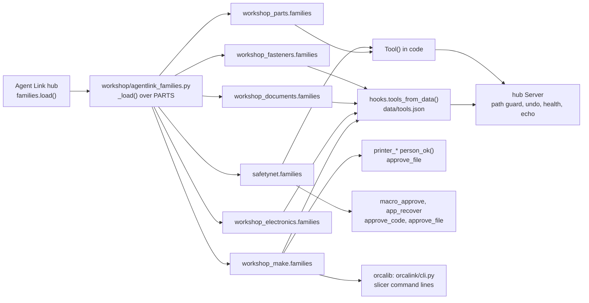

# How Workshop plugs into Agent Link
<!-- SPDX-License-Identifier: LGPL-2.1-or-later -->

Workshop is one add-on with six parts: Parts, Make, Electronics, Documents, SafetyNet and the Fasteners bridge.
This page tells how its tools reach the agent through Agent Link for FreeCAD (the hub). The hub's own flow is in [the hub's workflow pages](https://github.com/jamesK1000011/AgentLink-FreeCAD/blob/main/docs/workflow/README.md).

## How the hub finds it

- The hub loads any package on FreeCAD's path that holds `agentlink_families.py`. Here that is `workshop/agentlink_families.py`. The hub never names this add-on.
- `AGENTLINK_API = ">=1,<2"`. `LICENSE = "LGPL-2.1-or-later"`.
- `_load()` imports each part's `families` module in `workshop.PARTS` order: `workshop_parts`, `workshop_make`, `workshop_electronics`, `workshop_documents`, `safetynet`, `workshop_fasteners`. It joins their `FAMILIES`.
- A part that fails to load is left out (`LEFT_OUT`), and the log says why. The other parts still load.
- `_guides()` registers each part's `guides/` folder for `guide_read`.
- Without Agent Link, these modules are never loaded.

## Its tools and groups

| Part | Groups | Tools from |
|---|---|---|
| Parts | `parts` (lean) | code: `workshop_parts/fam_parts.py` (`gen_part`, `gen_make`) |
| Make | `make` (lean), `fits` (lean), `mass`, `thread`, `embed`, `slice`, `printer`, `cut`, `mill`, and `strength` (joins the hub's group) | data: `workshop_make/data/tools.json` |
| Electronics | `electronics` | data: `workshop_electronics/data/tools.json` |
| Documents | `drawing`, `share` | data: `workshop_documents/data/tools.json` |
| SafetyNet | `core` (joins the hub's group: `history_checkpoint`, `history_restore`), `safety` (macros, `app_recover`, settings history) | code: `safetynet/fam_history.py`, `safetynet/fam_safety.py` |
| Fasteners | `fasteners`, only when the Fasteners Workbench is installed | data: `workshop_fasteners/data/tools.json` |

- The data tools are bound to their handlers with the hub's `hooks.tools_from_data()`.
- A lean group is listed only when the hub's tool list is in `classic` mode. In the default `static` mode, the agent finds a tool with `tool_find` and calls it by name.

## Hooks

- `hooks.extend_tool()`: Make adds inputs to the hub's `fea_setup` and `fea_solve` (`workshop_make/printed.py`). The Fasteners bridge adds `screw` to `hw_hole`.
- `hooks.provide()`: `print_pauses` (Make), `checkpoints` and `reopen` (SafetyNet), and Make's services (`workshop_make/services.py`).
- `hooks.on()`: SafetyNet listens to `after_change` (auto-save, recovery notes), `setting_changing` and `setting_changed` (settings history), and `reply_written`. After each reply of a supervised hidden FreeCAD, `recovery.write_hidden()` writes what it holds, so a FreeCAD started again after a crash can recover it.
- `hooks.register_reviewer()`: Make's review.
- `hooks.register_tab()`: Make's, Documents' and SafetyNet's panels are docks of their own. Only when the hub cannot place a dock (`layout.hosted_tabs()`), the part registers it as a tab of the Agent Link panel.

## What it reads and writes

- **Reads.** The FreeCAD document. Files that the agent names, through the hub's path guard. Make's `printer_send` reads its G-code through the hub's read check (`paths.in_file`).
- **Writes, in files.** `drawing_make` and `mill_export` have `writes: true`. Slicing writes G-code in the output folder. The slicer profiles that `slice_with` takes (`profiles.*`) are checked as reads (`paths.in_file`).
- **Slicing.** Make slices with the slicer the person uses: PrusaSlicer, OrcaSlicer or Bambu Studio. It drives their command lines through Agent Link for OrcaSlicer's `orcalink/cli.py` (`workshop_make/orcalib.py`).
- **Printers.** Printers are kept in `~/AgentLink/printers.json` (or `$AGENTLINK_HOME`), with their API keys (`workshop_make/printers.py`). The hub's path guard never lets a tool read or write that file.

## Approvals

The person approves through the client: `approve_file` or `approve_code`, set in the client's tool permissions. A typed `confirm` is not taken with Agent Link.

- `printer_send` with `start: true`, or with G-code commands to look at, and `printer_pause` and `printer_stop`: `approve_file`, kind `dialog` (`workshop_make/handlers/printer.py` `person_ok()`). The approval binds the action, the printer's name and address, and the G-code file's SHA-256.
- `app_recover { action: "accept" }` (SafetyNet): `approve_file`, kind `recover`.
- `macro_approve` (SafetyNet): `approve_code`, kind `macro`. The approval holds until the macro's file changes.

## Diagram

